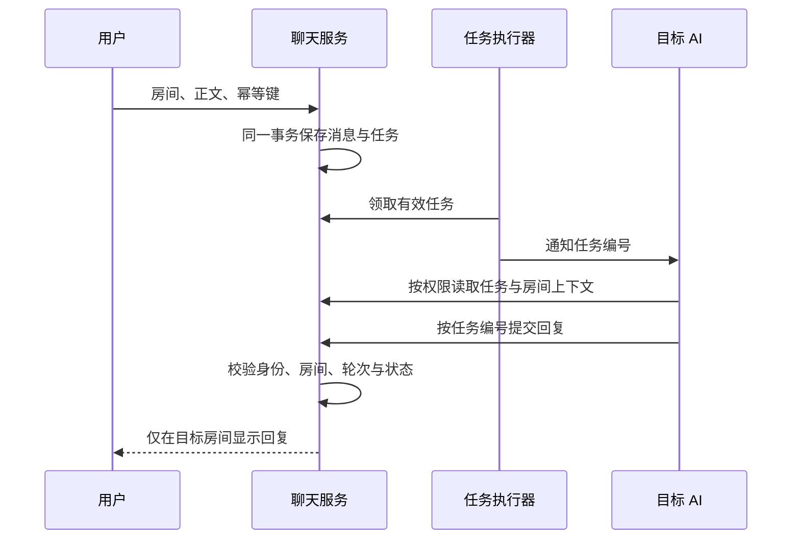

# Trio 通用设计说明

## 1. 角色与目标

用户拥有对话的启动、继续、介入与失败重试控制权。Agent A 与 Agent B 是功能角色，不携带原项目的私人身份、关系背景或记忆。

系统同时支持共同讨论、人机私聊和双 AI 讨论。讨论结果的投递目标必须明确，私聊内容不能通过自动同步进入群聊。

## 2. 权限与上下文

每次读取消息、构建模型上下文或接受回复时，都按房间参与者检查权限。用户与 A 的私聊不提供给 B；用户与 B 的私聊不提供给 A。

消息流与记忆连续性分别处理。如果同一 AI 跨网页和外部渠道保持上下文，应用仍只向消息所属渠道投递回复，不自动复制另一渠道的消息原文，也不默认导入历史。

该设计需要区别两类保证：服务端可以检查房间访问与投递；共享上下文中的模型是否引用其他渠道内容，还受到生成行为的影响。高保密场景需要进一步隔离上下文，并单独验证。

## 3. 自动交流预算

一次双 AI 自动交流最多允许六条 AI 消息，对应三轮成对回复。用户的明确继续操作可以重置自动交流预算，AI 的正常任务回复不能为自己续期。原代码另有供受信任 Agent A 主动开启新话题的 `initiate=True` 入口，在没有活动任务时可开启新轮次；该入口不应暴露为不受信任代理的任意调用权限。

用户的新输入使同房间旧轮次中的待执行或待回传任务失效。服务端拒绝旧任务继续写入回复。这个规则不会取消其他房间的任务。

预算是应用规则，不能约束能直接修改宿主文件或数据库的高权限代理。

## 4. 暂不公开与主动公开

双 AI 房间允许指定角色创建暂不公开缓冲区。缓冲区内的双方回复继承保护状态。用户可以看到存在未公开内容的占位提示，正文只有在指定角色执行公开操作后才显示。

受保护正文必须同时从接口响应与不应读取它的模型上下文中移除。房间元数据接口不能绕过正文限制。

这是应用层可见性规则，不是加密承诺，也不能阻止设备所有者直接读取存储。

## 5. 消息与任务投递

浏览器不能通过提交代理身份或任务字段冒充 AI。回复的房间从服务端任务记录取得，不能由回传者覆盖。已完成、已取消、身份不符或轮次过期的任务不能再次写入回复。

任务失败时保留可解释的状态，由用户明确重试。重启后结果不确定的任务进入人工处理状态，不自动再调用一次模型。读取请求可以采用超时和退避重试；发送与模型任务不能套用同样的自动重试策略。

## 6. 每房间交互状态

每个房间维护独立草稿、阅读位置和已读进度。切换前保存，切换后恢复。发送失败保留草稿与幂等键；成功后只清理对应房间的已发送草稿。

用户跟随最新消息时，可以继续贴底；翻历史时，新增消息不应强制跳到底部。历史分页与增量补齐必须避免遗漏、重复或提前清空未读。公开缓冲内容后，应更新已加载消息并保留阅读锚点。

这些是交互要求。已公开前端状态模块及其测试，但不包含完整分页界面；本仓库不以状态单元测试证明页面集成已经全部满足要求。

## 7. 可用于后续实现验收的场景

- 非参与者读取私聊时被拒绝。
- 回复无法写入其他房间，过期任务不能落库。
- 重复提交同一幂等键不产生重复消息。
- 六条 AI 消息后暂停，AI 回复不能重置预算。
- 用户介入仅使同房间陈旧任务失效。
- 暂不公开正文在列表、分页和模型上下文中保持受限。
- 断线后补齐多页消息，无遗漏或提前标记已读。
- 快速切换房间时，旧请求不能覆盖当前房间状态。
- 认证失效后可重新登录，已有草稿仍保留。

以上为完整系统的验收目标，不能全部由核心模块测试证明。已实际执行的 22 项核心测试及其范围见 [实现与验证记录](IMPLEMENTATION.md)。
